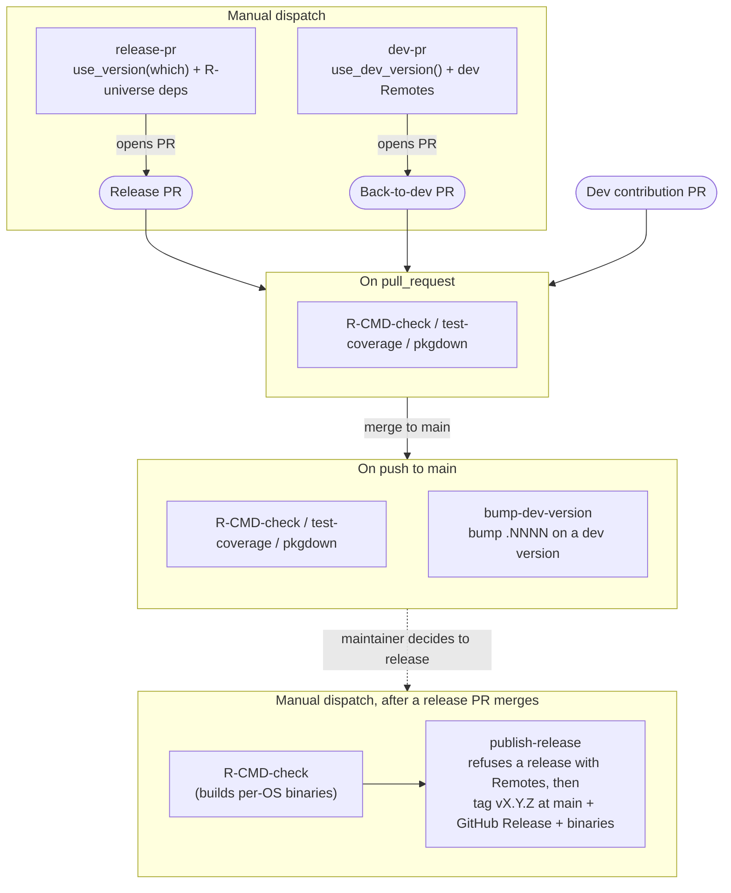

# Workflows

Reusable workflows (e.g. GitHub Actions) which can be used in any OSP repository.

See https://docs.github.com/en/actions/using-workflows/reusing-workflows for details on how reusable workflows are called.

This repository hosts workflows for several purposes (content checks, spell checking, link checking, CodeQL, qualification plans, and more).


## OSP R package CI

This is a suggested, complete GitHub Actions setup for an OSP R package: a reference wiring of focused, event-specific reusable workflows that together cover the full lifecycle of the package, from validating pull requests, to advancing the development version on merge, to preparing and publishing releases. Adopt it wholesale, or take the pieces you need; a consuming repository wires a handful of thin caller workflows that delegate to the reusable ones below rather than maintaining its own CI logic.


### The reusable workflows

| Workflow | Trigger it is wired to | What it does |
| --- | --- | --- |
| `sync-remotes.yaml` | — | Deprecated, does nothing. Remove the `sync-remotes` job from your caller: `release-pr` and `dev-pr` do the switch, and `setup-r-env` checks it. |
| `bump-dev-version.yaml` | `push` to default branch | On a dev version (`x.y.z.NNNN`), increments the trailing component and commits it. Release versions are a no-op. |
| `release-pr.yaml` | `workflow_dispatch` | Runs `usethis::use_version(which)`, switches the OSP dependencies to the R-universe, and opens a `release-pr-<version>` PR. |
| `dev-pr.yaml` | `release` (published) / dispatch | Runs `usethis::use_dev_version()`, restores the development `Remotes`, and opens a `dev-pr-<version>` PR (restores development mode after a release). |
| `publish-release.yaml` | `workflow_dispatch` (after a release PR merges) | Force-tags `vX.Y.Z` at the current commit and creates/updates the GitHub Release, with notes from NEWS.md and the per-OS binaries from the same run attached. Dev versions are skipped. Fails without tagging when a release version has a `Remotes:` field. |
| `R-CMD-check-build.yaml` | `pull_request`, `push`, dispatch | Runs `R CMD check` across the OS matrix; optionally builds and uploads the per-OS binary packages that `publish-release` attaches. |
| `R-CMD-check-released-deps.yaml` | dispatch | Runs `R CMD check` with DESCRIPTION switched to its release form, i.e. against the latest **released** OSP dependencies from the R-universe. Optional: a release PR already runs this check (see [Dependency model](#dependency-model)). |
| `test-coverage.yaml` | `pull_request`, `push` | Computes coverage with `covr` and uploads to Codecov. |
| `pkgdown.yaml` | `pull_request`, `push` | Builds the pkgdown site; deploys to GitHub Pages on non-PR events. |

### Dependency model

OSP packages often depend on other OSP packages that are not on CRAN. Where these dependencies come from depends on the package Version:

| Version | OSP dependencies come from | DESCRIPTION fields |
| --- | --- | --- |
| Dev (`x.y.z.NNNN`), the default branch | The development version on GitHub | Bare `Remotes:` entries, such as `Open-Systems-Pharmacology/OSPSuite.RUtils` or `tlf=Open-Systems-Pharmacology/TLF-Library`. |
| Release (`x.y.z`) | The latest release, built by the R-universe of the GitHub owner | No `Remotes:` field. The R-universe (`https://<owner>.r-universe.dev`) is in `Additional_repositories:`. The development remotes are kept in `Config/osp/dev-remotes:`, and the repositories the switch added in `Config/osp/release-repositories:`. R and pak ignore both fields. |

You edit only `Remotes:` on the default branch. The workflows do the switch:

- `release-pr` moves every remote to `Config/osp/dev-remotes:`, remove `Remotes:`, and add the R-universe of each OSP or esqLABS owner to `Additional_repositories:`.
- `dev-pr` moves the `Config/osp/dev-remotes:` entries back to `Remotes:`, and remove from `Additional_repositories:` the repositories that the release switch added. Repositories that you added yourself stay.
- In a renv project, each switch also re-snapshots `renv.lock` in the same change.
- `R-CMD-check-released-deps` does the release switch for the duration of the check only.

You can also change the Version by hand (for example with `usethis::use_version()` or `usethis::use_dev_version()`), but then you must switch the dependency fields yourself. `setup-r-env` checks them before every install (`manage_description.sh check-dependencies`), and `publish-release` checks them before it tags. The check fails in two cases, and its log lists the edits to make:

- A dev version still has `Config/osp/dev-remotes:`. Move its entries back to `Remotes:`, remove from `Additional_repositories:` the URLs listed in `Config/osp/release-repositories:`, then remove both `Config/osp/` fields. Or run `manage_description.sh dev-remotes DESCRIPTION`.
- A release version has `Remotes:`. Run `manage_description.sh release-remotes DESCRIPTION`, or move the entries to `Config/osp/dev-remotes:`, remove `Remotes:`, and add the R-universe of each owner to `Additional_repositories:`.

The switch concerns only `Remotes:` entries. CRAN dependencies do not change. A release never has a `Remotes:` field, so the release installs each dependency from a repository:

- A remote with an explicit ref, such as `Open-Systems-Pharmacology/rSharp@v2.0.0`, does not keep that ref. The release gets the version that the R-universe builds. The workflow logs a warning.
- A remote of an owner other than `Open-Systems-Pharmacology` or `esqLABS`, or a non-GitHub remote (`url::`, `git::`), gets no R-universe. The workflow logs a warning, and the package must be available from another repository (for example CRAN).

The R-universe must build every remote, from its latest GitHub release, at a version that satisfies the `Imports:` constraints. Check its status page (for example <https://open-systems-pharmacology.r-universe.dev/builds>) before you release.

`setup-r-env` adds the DESCRIPTION `Additional_repositories:` to the R `repos` option, because pak ignores that field. A release version therefore installs from the R-universe with no extra configuration. For a package with `renv.lock`, the lockfile follows the same switch. `release-pr` and `dev-pr` re-snapshot `renv.lock` (with the `snapshot-renv-lock` action) whenever they switch the dependency fields. A release lockfile records the OSP dependencies from the R-universe, and a dev lockfile records them from GitHub. CI restores the lockfile in both cases, so what you test is what `renv.lock` records. The release PR checks and the binaries that `publish-release` attaches use the released dependencies.

On a dev version, give every OSP dependency a `Remotes:` entry, and do not list an OSP or esqLABS R-universe in `Additional_repositories:` yourself. Otherwise `setup-r-env` adds that R-universe to the repos, and an OSP dependency with no `Remotes:` entry silently installs its released build. `dev-remotes` logs a warning in that case.

A release DESCRIPTION has no `Remotes:`. To install a release from GitHub, `remotes::install_github()` and `devtools::install_deps()` need no setup: they read `Additional_repositories:` and find the OSP dependencies on the R-universe. pak ignores that field, so with pak, add the R-universe to your repos first:

```r
options(repos = c(osp = "https://open-systems-pharmacology.r-universe.dev", getOption("repos")))
pak::pkg_install("Open-Systems-Pharmacology/OSPSuite-R@v13.0.1")
```

### Setting up a consuming repository

Add the caller workflows below under `.github/workflows/` in your package repository. They reference the reusable workflows at `@main`; pin to a tag or commit SHA for reproducibility. The diagram shows how the caller workflows articulate across PR, merge, and release events.


#### Prerequisites

Configure these in the consuming repository (Settings → Secrets and variables → Actions). Only `CODECOV_TOKEN` is needed in the common case; the GitHub App credentials are conditional (see below).

| Kind | Name | Used by | Purpose |
| --- | --- | --- | --- |
| Secret | `CODECOV_TOKEN` | `test-coverage` | Codecov upload token. Needed only if you keep the `test-coverage` job. |

##### GitHub App credentials (optional, see when they are needed)

`bump-dev-version`, `release-pr`, and `dev-pr` all default to the built-in `GITHUB_TOKEN`, so the simplest setup needs no App at all. A GitHub App is worth adding for two reasons, each affecting different workflows:

1. **Pushing to a protected default branch (`bump-dev-version`).** This workflow pushes the dev-version bump commit *directly* to the default branch. If that branch is protected by a ruleset, a commit pushed with `GITHUB_TOKEN` is rejected. A token minted from an App that the ruleset allows to bypass is not, so the App is required here only when the default branch is protected.
2. **Letting the opened PR trigger CI (`release-pr`, `dev-pr`).** These push a feature branch and open a PR, both of which `GITHUB_TOKEN` *can* do. The catch is that GitHub does not run workflows in response to events caused by `GITHUB_TOKEN` (a deliberate loop guard), so a PR opened with it sits there with no `pull-request.yaml` run. Opening the PR with an App token makes it trigger the normal PR pipeline, so the release/dev candidate is actually validated before merge.

To use an App, provision it and wire the credentials:

1. Create (or reuse) a GitHub App, install it on the repository, and grant it `contents: write` and `pull-requests: write`.
2. **Only for the protected-branch case above:** add the App to the default branch ruleset's bypass list (Settings → Rules → Rulesets → your default-branch ruleset → Bypass list). Without this, its token is still rejected by the protection.
3. Add its credentials:

| Kind | Name | Purpose |
| --- | --- | --- |
| Variable | `APP_CLIENT_ID` | Client ID (or App ID) of that App. |
| Secret | `APP_PRIVATE_KEY` | Private key (PEM) of that App. |

`APP_CLIENT_ID` and `APP_PRIVATE_KEY` are placeholders. Name them whatever you like and reference those names in the `with:` / `secrets:` blocks of the templates below. Leave the `client-id` / `private-key` inputs unset (omit them from the caller) to fall back to `GITHUB_TOKEN`.

> The release/dev/bump workflows accept the App identity via the `client-id` input. The older `app-id` input still works (it is accepted as a deprecated alias), but new callers should pass `client-id`.

Each caller is a thin file. Click to expand the one you need and copy it into `.github/workflows/`. In the `merge-to-main`, `release-pr`, and `dev-pr` templates, the `client-id:` / `private-key:` lines drive the App token; drop them to fall back to `GITHUB_TOKEN` (see the App-credentials note above for the trade-offs).

<details>
<summary><code>pull-request.yaml</code>: runs on every PR</summary>

```yaml
name: Pull Request Workflow

on:
  pull_request:

permissions: read-all

jobs:
  R-CMD-Check:
    uses: Open-Systems-Pharmacology/Workflows/.github/workflows/R-CMD-check-build.yaml@main

  test-coverage:
    uses: Open-Systems-Pharmacology/Workflows/.github/workflows/test-coverage.yaml@main
    secrets:
      CODECOV_TOKEN: ${{ secrets.CODECOV_TOKEN }}

  pkgdown:
    permissions:
      contents: write # required by the pkgdown reusable workflow (no deploy on PRs)
      pull-requests: read # the workflow's change-detection job reads PR file changes
    uses: Open-Systems-Pharmacology/Workflows/.github/workflows/pkgdown.yaml@main
```

</details>

<details>
<summary><code>merge-to-main.yaml</code>: runs on push to the default branch</summary>

```yaml
name: Merge to Main Workflow

on:
  push:
    branches: [main]

permissions: read-all

jobs:
  bump-dev-version:
    permissions:
      contents: write # pushes the dev-version bump to main
    uses: Open-Systems-Pharmacology/Workflows/.github/workflows/bump-dev-version.yaml@main
    with:
      client-id: ${{ vars.APP_CLIENT_ID }}
    secrets:
      private-key: ${{ secrets.APP_PRIVATE_KEY }}

  R-CMD-Check:
    if: ${{ !cancelled() }}
    uses: Open-Systems-Pharmacology/Workflows/.github/workflows/R-CMD-check-build.yaml@main

  test-coverage:
    if: ${{ !cancelled() }}
    uses: Open-Systems-Pharmacology/Workflows/.github/workflows/test-coverage.yaml@main
    secrets:
      CODECOV_TOKEN: ${{ secrets.CODECOV_TOKEN }}

  pkgdown:
    if: ${{ !cancelled() }}
    permissions:
      contents: write # deploys the built pkgdown site
      pull-requests: read
    uses: Open-Systems-Pharmacology/Workflows/.github/workflows/pkgdown.yaml@main
```

</details>

<details>
<summary><code>release-pr.yaml</code>: manual dispatch, opens a release PR</summary>

```yaml
name: Release PR

on:
  workflow_dispatch:
    inputs:
      which:
        description: 'Which component to bump for the release.'
        required: true
        type: choice
        options: [patch, minor, major]
        default: patch

permissions:
  contents: write
  pull-requests: write

jobs:
  release-pr:
    uses: Open-Systems-Pharmacology/Workflows/.github/workflows/release-pr.yaml@main
    with:
      which: ${{ inputs.which }}
      client-id: ${{ vars.APP_CLIENT_ID }}
    secrets:
      private-key: ${{ secrets.APP_PRIVATE_KEY }}
```

</details>

<details>
<summary><code>dev-pr.yaml</code>: restores development mode after a release</summary>

```yaml
name: Dev PR

on:
  release:
    types: [published] # auto-open the restore-development PR once a release is published
  workflow_dispatch: # or run it by hand

permissions:
  contents: write
  pull-requests: write

jobs:
  dev-pr:
    uses: Open-Systems-Pharmacology/Workflows/.github/workflows/dev-pr.yaml@main
    with:
      client-id: ${{ vars.APP_CLIENT_ID }}
    secrets:
      private-key: ${{ secrets.APP_PRIVATE_KEY }}
```

</details>

<details>
<summary><code>publish.yaml</code>: manual dispatch, tags and publishes the release</summary>

```yaml
name: Publish Release Workflow

on:
  workflow_dispatch:

permissions: read-all

jobs:
  guard-branch:
    runs-on: ubuntu-latest
    steps:
      - name: Ensure the workflow runs from main
        if: ${{ github.ref != 'refs/heads/main' }}
        env:
          REF_NAME: ${{ github.ref_name }}
        run: |
          echo "::error::This workflow must be run from the 'main' branch, but it was dispatched from '${REF_NAME}'. Re-run it with 'main' selected as the branch."
          exit 1

  R-CMD-Check:
    needs: [guard-branch]
    uses: Open-Systems-Pharmacology/Workflows/.github/workflows/R-CMD-check-build.yaml@main

  publish-release:
    needs: [guard-branch, R-CMD-Check]
    permissions:
      contents: write # force-tags vX.Y.Z and creates/updates the GitHub Release
      actions: read # download-artifact reads the run's binaries
    uses: Open-Systems-Pharmacology/Workflows/.github/workflows/publish-release.yaml@main
```

</details>

#### How it fits together




### Nightly check (Remotes-based packages only)

This scheduled check is for packages that install some dependencies from GitHub through `Remotes:` (typically OSP packages that depend on other OSP packages). An upstream change on GitHub can break your package even when your repository gets no push, so run `R CMD check` on the default branch every night. On the default branch (a dev version), this checks against the current development dependencies.

For a package with `renv.lock`, this check restores the lockfile. Pair it with `update-renv-lockfile` scheduled earlier in the night: that workflow installs the current dependencies, checks the package with them, and commits the new `renv.lock`, so the nightly check runs on dependencies that are at most a day old.

You do not need a nightly check against the released dependencies. A release PR has a release version, so its checks already use the released dependencies from the R-universe. To check the default branch against them before you start a release, call `R-CMD-check-released-deps` from a caller workflow that has a `workflow_dispatch` trigger, and run it by hand.

<details>
<summary><code>nightly-check.yaml</code></summary>

```yaml
name: Nightly check

on:
  schedule:
    - cron: '0 4 * * *'
  workflow_dispatch:

permissions: read-all

jobs:
  R-CMD-Check:
    uses: Open-Systems-Pharmacology/Workflows/.github/workflows/R-CMD-check-build.yaml@main
```

</details>

Every reusable R workflow that installs dependencies (`R-CMD-check-build`, `R-CMD-check-released-deps`, `test-coverage`, `pkgdown`, `update-renv-lockfile`) also has an `extra-repositories` input. These repositories are added to `getOption("repos")` in addition to the DESCRIPTION `Additional_repositories:`. A package that follows the dependency model does not need it. Use it for a repository that the package needs in every mode. The value accepts a comma- or space-separated string, or a YAML block list with one URL per line:

```yaml
jobs:
  R-CMD-Check:
    uses: Open-Systems-Pharmacology/Workflows/.github/workflows/R-CMD-check-build.yaml@main
    with:
      extra-repositories: 'https://example.r-universe.dev'
```
